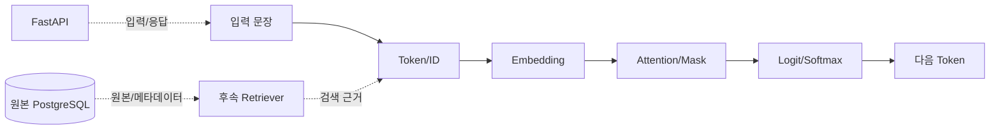

# 일일프로젝트: 문장 하나가 LLM 출력이 되기까지

입력: 실습 파일은 개인 폴더에 보관합니다.

- Token 및 Special Token 포함 입력 길이: 8
- Token IDs: [2, 10, 15, 5, 16, 7, 4, 3]
- 교육용 Cosine A-B / A-C: 0.9701 / -1.0000
- Causal Mask Attention Row Sum: [1.0, 1.0, 1.0]
- 다음 Token 예시 선택: 출력A

주의: 그림은 개념적 위치 표시이며 오늘 실제 RAG·Agent 서비스를 실행한 것이 아닙니다.
