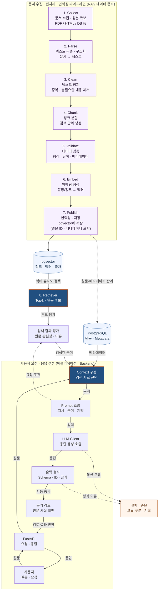
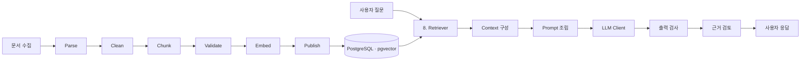

# 실무 RAG 파이프라인 전체 지도

## 1. 전체 도식

## 2. 문서 준비와 질문 처리의 연결

## 3. 각 단계의 위치와 역할

> **1~7단계**는 문서 수집·전처리·인덱싱(데이터 준비)이고, **8단계**는 질문 시점의 검색(Retrieval)입니다.  

| No. | 단계 | 주요 역할 |
|:---:|---|---|
| 1 | Collect | PDF·HTML·DB 등의 원본 수집 |
| 2 | Parse | 파일에서 텍스트를 추출하고 구조화 |
| 3 | Clean | 중복·불필요한 내용 정제 |
| 4 | Chunk | 검색 가능한 크기로 텍스트 분할 |
| 5 | Validate | 청크의 형식·길이·메타데이터 검증 |
| 6 | Embed | 청크를 임베딩 벡터로 변환 |
| 7 | Publish | 청크·벡터·원문 ID·메타데이터 저장 및 검색 가능 상태로 등록 |
| 8 | Retriever | 저장된 데이터에서 관련 원문 후보를 Top-k로 검색 |